# Отчёт по домашнему заданию VPh06

## О проекте

Реализован функциональный сайт фотографа, ориентированный на клиентов в Германии, и связанная с ним мини-CRM. Публичная часть поддерживает немецкий, английский и русский языки, светлую и тёмную темы, мобильную вёрстку, каталог услуг и форму заявки с выбором услуги, бюджета и способа связи, а также согласием на обработку данных.

В административной части доступны авторизация, управление услугами, заявки с автоматической оценкой приоритета, клиенты, съёмки, задачи, платежи и статистика сайта с тепловой картой. PostgreSQL используется как основная база; предусмотрена синхронизация рабочих данных с отдельной Google-таблицей. Для запуска используются Docker Compose, FastAPI, Nginx и HTTPS.

На данном этапе визуальное оформление намеренно базовое: работа сосредоточена на функциональности. Позднее сайт можно адаптировать под фирменный стиль и исходные материалы заказчика.

## Скриншоты работающего проекта

### Сайт на компьютере

| Язык | Тема | Скриншот |
|:--|:--|:--|
| Deutsch | Светлая | 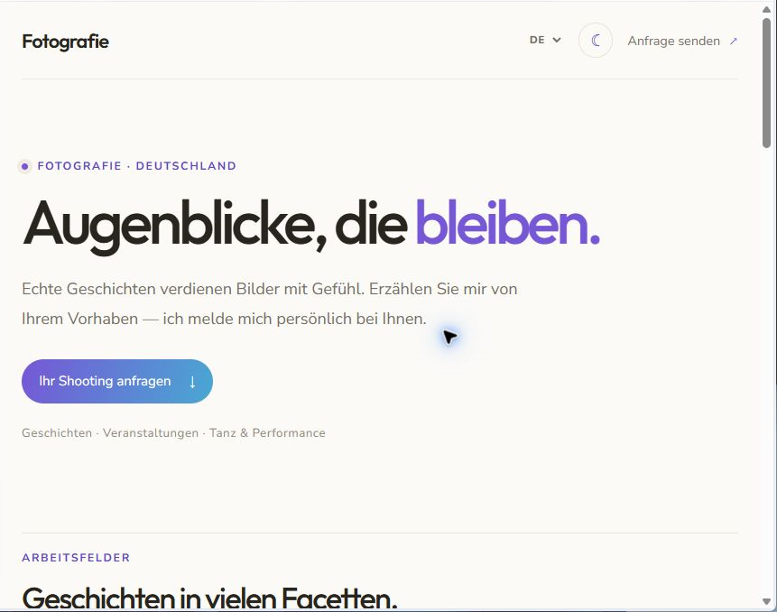 |
| Deutsch | Тёмная | 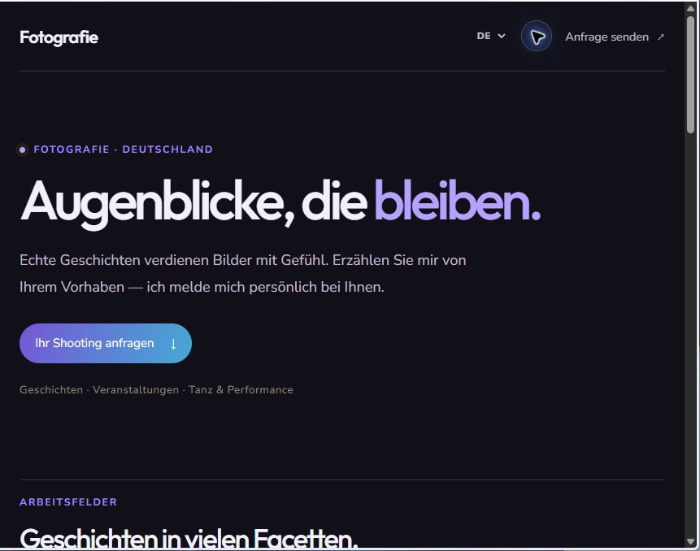 |
| English | Тёмная | 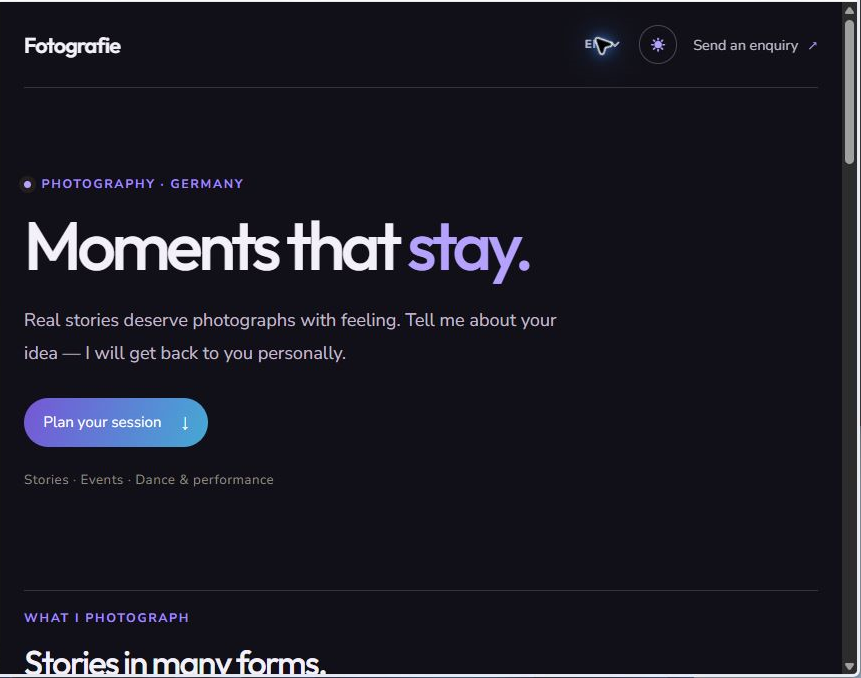 |
| Русский | Светлая | 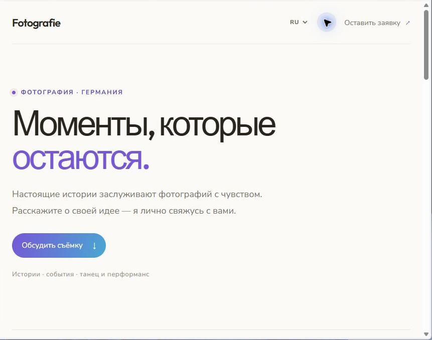 |

### Сайт на телефоне — три языка и две темы

| Язык | Светлая тема | Тёмная тема |
|:--|:--:|:--:|
| Deutsch | 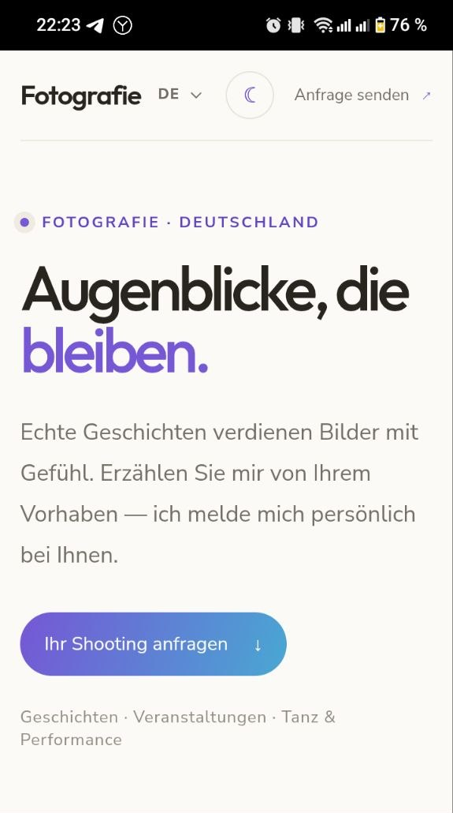 | 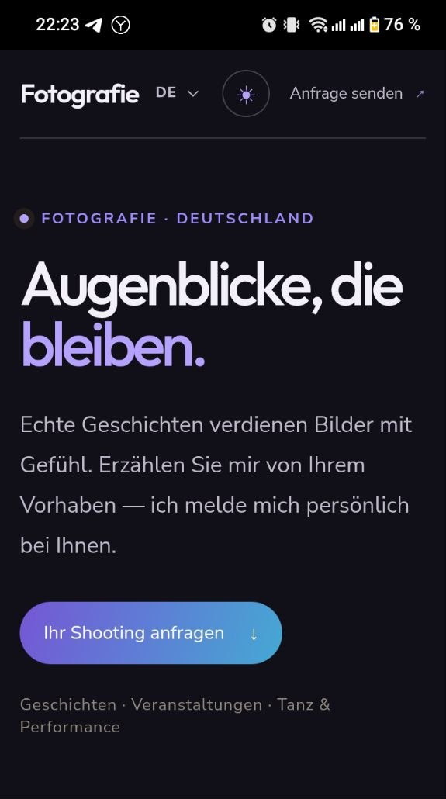 |
| English | 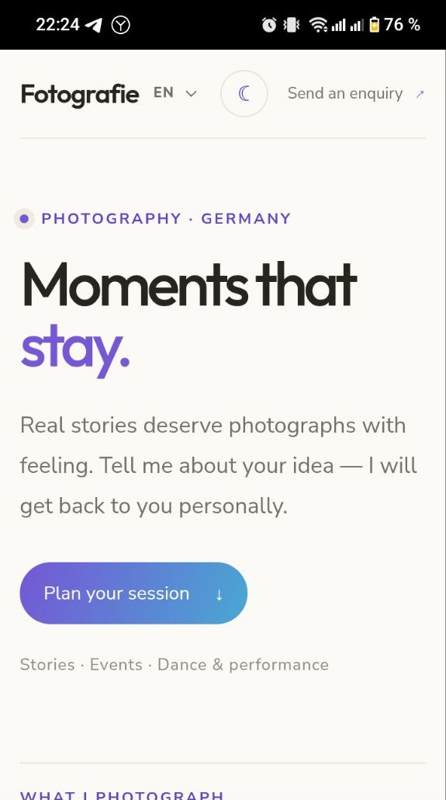 | 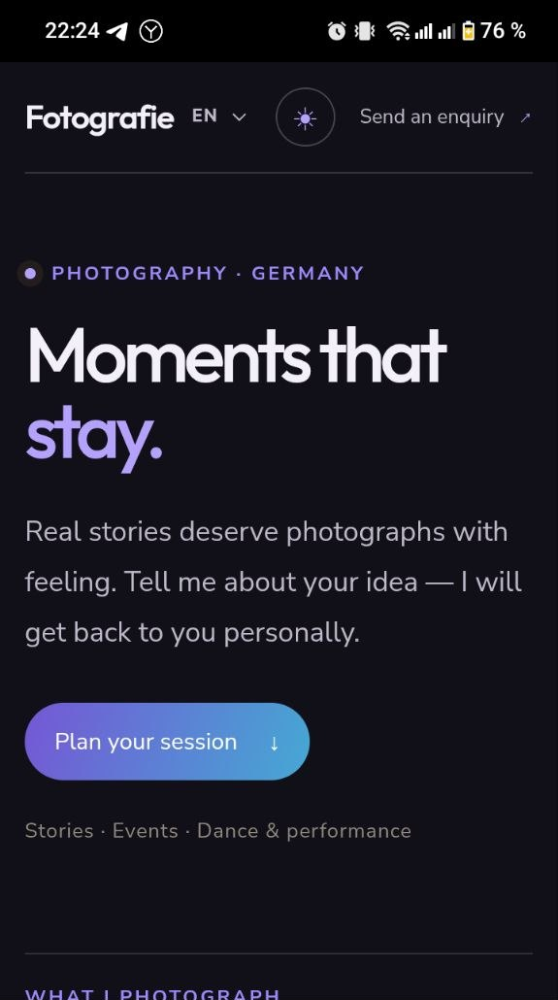 |
| Русский | 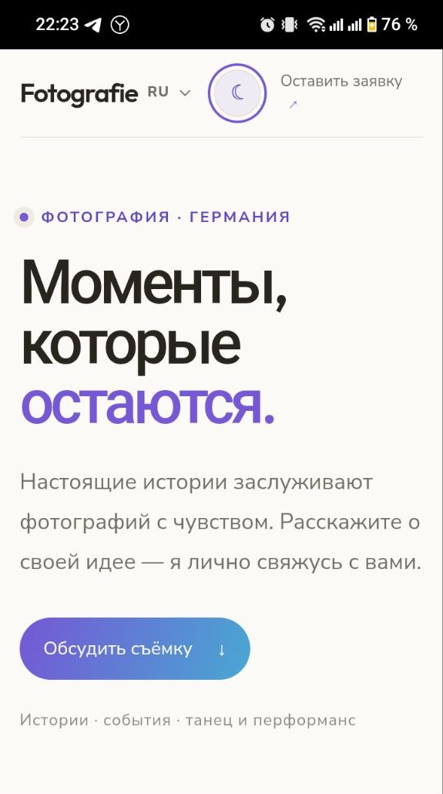 | 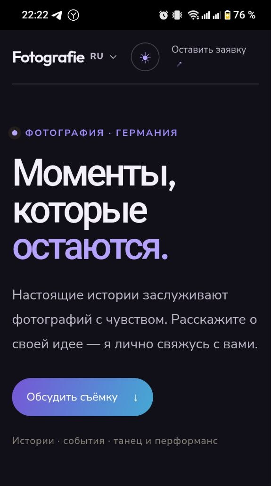 |

### Форма заявки

| Начало формы | Согласие и отправка |
|:--:|:--:|
| 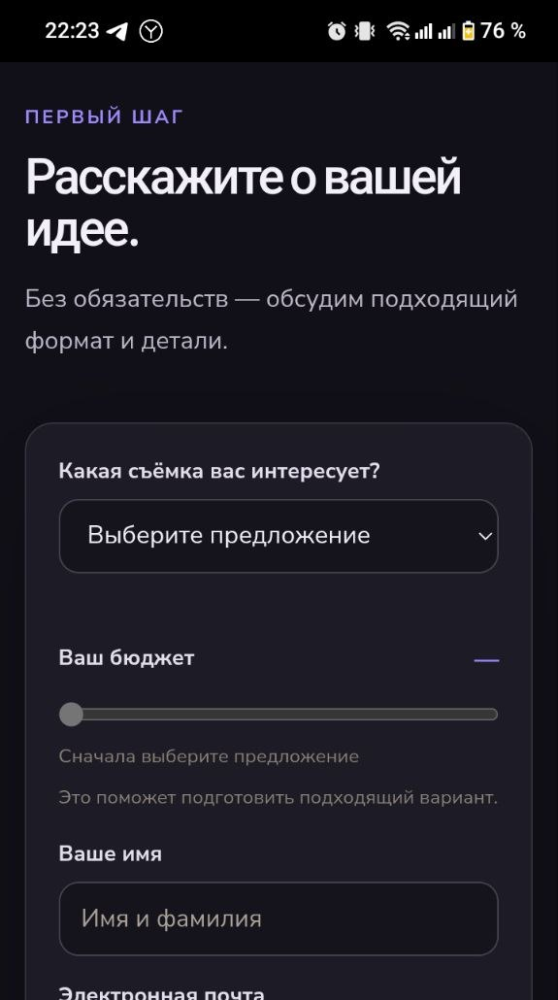 | 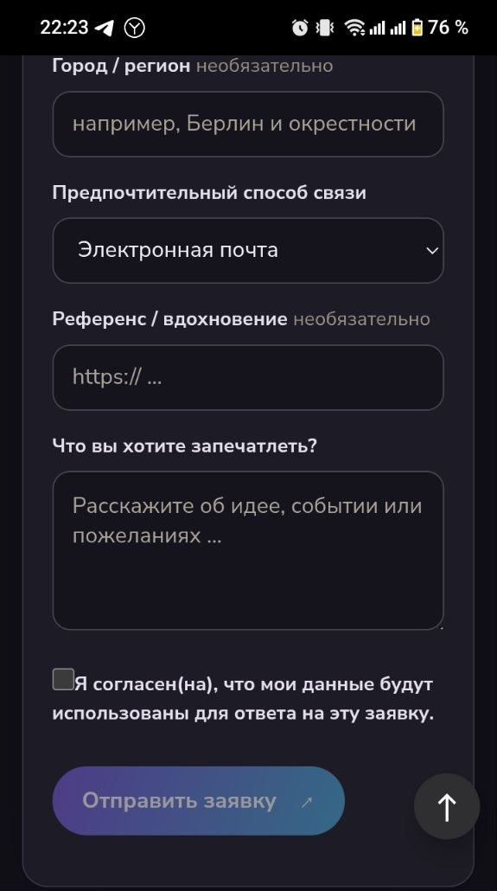 |

## 1. Авторизация и администрирование

- Первый администратор зарегистрирован. Повторная регистрация отключена: `/auth/registration-status` возвращает `{"enabled":false}`.
- Авторизация через Swagger UI работает: аутентифицированный запрос `GET /admin/services` возвращает HTTP 200.

## 2. Управление услугами

- Через таблицу админ-панели добавлено более пяти демонстрационных услуг.
- Редактирование услуги работает через интерфейс и API (`PATCH`, HTTP 200).
- Удаление услуги реализовано как деактивация для сохранения истории. `DELETE` возвращает HTTP 204; неактивная услуга отсутствует в публичном каталоге и остаётся в административной истории.
- CRUD через API подтверждён статусами: `GET` — HTTP 200, `POST` — HTTP 201, `PATCH` — HTTP 200, `DELETE` — HTTP 204.

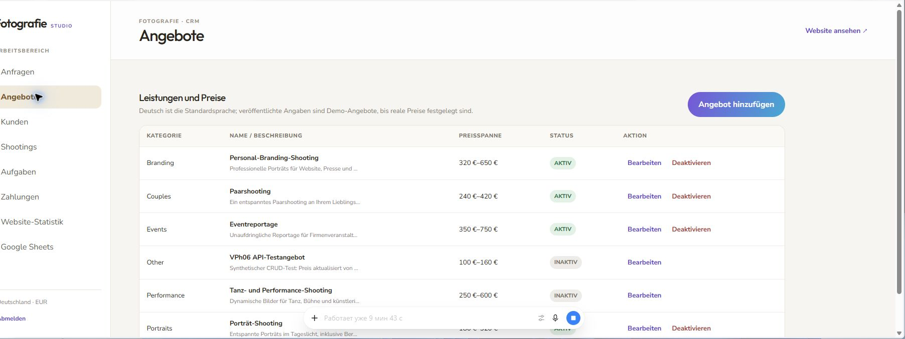

## 3. Сбор и анализ метрик

- В статистике доступны периоды «Сегодня», «Эта неделя», «Этот месяц» и тепловая карта. Для текущего дня панель показывает 1 визит, среднее время 6:28, 17 взаимодействий и 2 округлённые точки курсора.
- В PostgreSQL в таблице `behavior_metrics` записано 43 тестовых события: `cursor` — 6, `form_start` — 2, `heartbeat` — 30, `page_end` — 1, `page_view` — 2, `service_view` — 2. Содержимое полей формы не сохраняется; координаты курсора округляются до сетки 20×12.

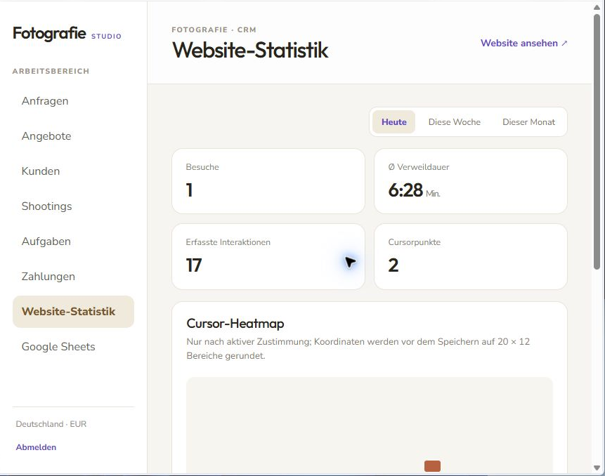

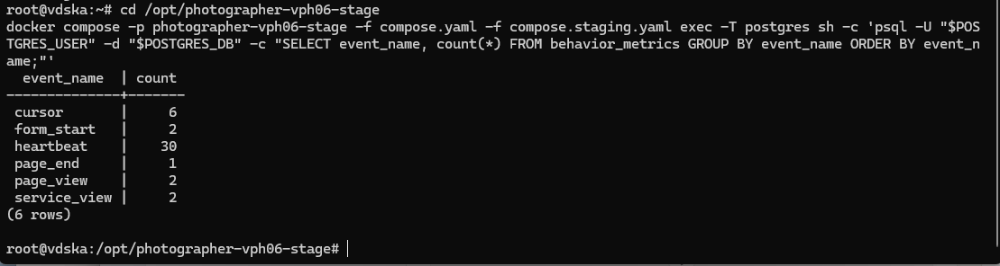

## 4. Тестирование системы приоритизации

- Созданы 10 синтетических заявок: 4 срочных, 3 средних и 3 низких.
- В списке админ-панели отображаются 4 `hot`, 3 `warm` и 3 `cold` заявки, отсортированные по приоритету. В карточках доступны детали и факторы присвоения приоритета.
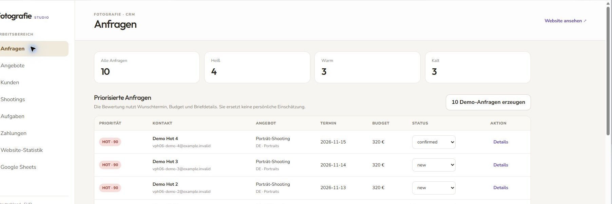

## 5. Безопасность и развёртывание

- Контейнеры пересобраны и запущены с production-конфигурацией. Публичный сайт доступен через HTTPS на порту 443.
- Backend привязан к loopback-интерфейсу и доступен для администрирования через SSH-туннель. PostgreSQL не публикует host-порт.
- Внешние TCP-подключения к портам 80, 8000, 5432, 5050 и 5000 недоступны. pgAdmin и Docker Registry выключены.
- При закрытом TCP-порте HTTP-ответ 403 не формируется: внешнее подключение отклоняется на сетевом уровне.

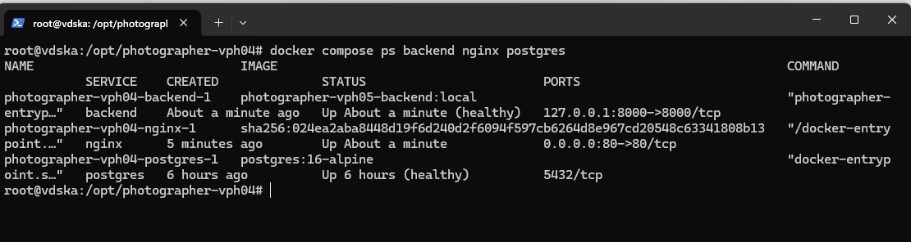

## 6. Логи и отладка

- Для диагностики использовались Docker-логи backend и Nginx.
- Конфигурация Compose проверена. Frontend собран командой `npm run build` в папке `frontend`; Docker-команды выполнялись отдельно.

## Материалы для сдачи

- Скриншоты работающего проекта включены в этот отчёт.
- Исходный код и конфигурационные файлы доступны в этом репозитории. Секреты и локальный `.env` не включены.

